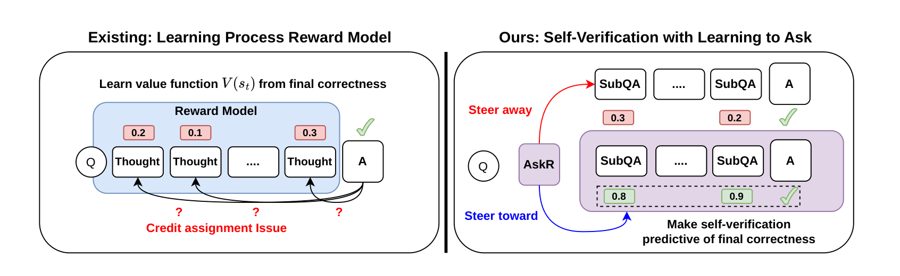

<div align="center">

# RLVR from Within: Learning to Ask to Elicit Intrinsic Rewards for Test-Time Reasoning

[Kuang-Da Wang](https://kuangdw.github.io/)<sup>1,†</sup>, [Kai-Jie Lin](https://kjldefeated.github.io/)<sup>2,†</sup>, Guo-Xun Ko<sup>3</sup>, Yu-Heng Lin<sup>2</sup>, Yu Heng Hung<sup>1</sup>,
Travis M. Bartley<sup>2</sup>, Shuoyang Ding<sup>2</sup>, Yu-Chiang Frank Wang<sup>2,3</sup>,
Chao-Han Huck Yang<sup>2</sup>, Guan-Ting Liu<sup>2</sup>, Wen-Chih Peng<sup>1</sup>, [Ping-Chun Hsieh](https://pinghsieh.github.io/)<sup>1</sup>

<sup>1</sup>National Yang Ming Chiao Tung University &nbsp; <sup>2</sup>NVIDIA &nbsp; <sup>3</sup>National Taiwan University &nbsp; <sup>†</sup>Equal contribution

[](https://meta-agents-workshop.github.io/)
[](docs/static/pdfs/AskR_paper.pdf)
[](https://rl-bandits-lab.github.io/AskR/)


</div>

**AskR** learns *what to ask* so that a frozen reasoner's own self-verification becomes a reliable
intrinsic reward. Instead of training an external process reward model (PRM), AskR trains a
sub-question policy that structures reasoning into sub-questions and sub-answers (SubQAs). The
reasoner checks every SubQA, and the mean of these checks guides test-time optimization.

- **Better than PRMs:** with the same optimizer, AskR beats PRM-guided reasoning by **+7.12 points on average**, and by up to +9.18.
- **Data-efficient:** AskR beats RLVR on average while using only **5%** (text) and **17%** (vision) of RLVR's training data.
- **Reusable:** one 4B AskR steers Qwen3 reasoners from 1.7B to 32B.

## Installation

```bash
conda create -n askr python=3.11 -y
conda activate askr
pip install -r requirements.txt
```

The versions in `requirements.txt` are pinned together: unsloth, trl, vllm and torchao break each other
across versions. All experiments ran on a single NVIDIA RTX PRO 6000 Blackwell (96 GB).

## Quick Start

### Training

```bash
# Text
python trainers/askr_trainer.py --model Qwen/Qwen2.5-7B-Instruct --dataset math --output-dir askr

# Vision
python trainers/askr_trainer.py --model Qwen/Qwen2.5-VL-7B-Instruct --dataset lpt30k --visual-mode --output-dir askr_vl
```

### Inference

```bash
python AskR_Solver.py \
  --model Qwen/Qwen2.5-7B-Instruct \
  --lora-path ./outputs/train/askr_<timestamp>/final_model \
  --mode tmpc \
  --dataset lab-bench
```

- Each run produces one answer per question and writes `overall_accuracy` (unparseable answers count as
  wrong) to `outputs/eval/`. The paper reports the mean over **8 independent runs**:

  ```bash
  for t in $(seq 1 8); do
    python AskR_Solver.py --lora-path <adapter> --dataset lab-bench --output outputs/eval/lab-bench_trial$t.json
  done
  ```

- **Vision:** add `--model Qwen/Qwen2.5-VL-7B-Instruct --visual-mode` and use `--dataset vstar`, `mmstar`
  or `cvbench`.
- **Separate asker and reasoner:** one 4B asker can guide a larger Qwen3 reasoner:

  ```bash
  python AskR_Solver.py --asker-model Qwen/Qwen3-4B --lora-path <adapter> --model Qwen/Qwen3-32B \
    --gpu-memory-utilization 0.65 --asker-gpu-memory-utilization 0.2 --dataset mmlu
  ```

- `--mode askr` skips TMPC. It samples `--n-samples` SubQA trajectories per question and reports their mean accuracy.
- Omit `--lora-path` to run the untrained asker.

## Data

The evaluation benchmarks are downloaded from the Hugging Face Hub.

**`mixed_math_stem_dataset`** We use half math and half STEM for training. It holds math and STEM problems from SYNTHETIC-1.:

| `type` | Source | `answer` | Graded by |
| --- | --- | --- | --- |
| `math` | [`PrimeIntellect/verifiable-math-problems`](https://huggingface.co/datasets/PrimeIntellect/verifiable-math-problems) | `verification_info["ground_truth"]` (LaTeX) | `math-verify` |
| `stem` | [`PrimeIntellect/stackexchange-question-answering`](https://huggingface.co/datasets/PrimeIntellect/stackexchange-question-answering) | `gold_standard_solution` | LLM judge (score 0–1; > 0.5 counts as correct) |

`--dataset math` and `--dataset stem` load these two sources directly from the Hub.

**`LongPerceptualThoughts-30k/`** is built from
[LongPerceptualThoughts-30k](https://huggingface.co/datasets/andrewliao11/LongPerceptualThoughts-30k) and the
[DOCCI](https://huggingface.co/datasets/google/docci) images. Build the rest from the project root:

```bash
cd data/LongPerceptualThoughts-30k
huggingface-cli download andrewliao11/LongPerceptualThoughts-30k --repo-type dataset \
  --revision 5e8d7ab7a447e5b2d2d991b2320aafdd423c249d --local-dir .
mkdir -p docci && cd docci
wget https://storage.googleapis.com/docci/data/docci_descriptions.jsonlines
wget https://storage.googleapis.com/docci/data/docci_images.tar.gz
tar -xzf docci_images.tar.gz && rm docci_images.tar.gz   # -> docci/images/
cd .. && python merge_with_docci_and_convert_to_sharegpt.py   # -> LongPerceptualThoughts_SFT.json
```

The ground-truth letter of each question comes from the `<answer>` tag of its assistant message.

**LLM judge (STEM rows only).** The judge is called through an OpenAI-compatible API:

```bash
export DEEPINFRA_API_KEY=...            # default provider: DeepInfra, model deepseek-ai/DeepSeek-V3.2
# or
export LLM_JUDGE_PROVIDER=openai OPENAI_API_KEY=...   # model gpt-4o
export LLM_JUDGE_MODEL=...              # optional: override the judge model
```

**Benchmarks:**

| `--dataset` | Benchmark | Split | Modality |
| --- | --- | --- | --- |
| `mmlu` | [MMLU-Pro](https://huggingface.co/datasets/TIGER-Lab/MMLU-Pro) (physics, chemistry, CS, math, biology, health, engineering) | test | text |
| `lab-bench` | [LAB-Bench](https://huggingface.co/datasets/futurehouse/lab-bench) (CloningScenarios, ProtocolQA, SeqQA) | train* | text |
| `scieval` | [SciEval](https://huggingface.co/datasets/OpenDFM/SciEval) | test | text |
| `vstar` | [V* Bench](https://huggingface.co/datasets/craigwu/vstar_bench) | test | image |
| `mmstar` | [MMStar](https://huggingface.co/datasets/Lin-Chen/MMStar) (coarse, fine-grained perception, instance reasoning) | val | image |
| `cvbench` | [CV-Bench](https://huggingface.co/datasets/nyu-visionx/CV-Bench) (2D) | test | image |


## Acknowledgements

The LLM judge builds on [Genesys](https://github.com/PrimeIntellect-ai/genesys). Training uses
[Unsloth](https://github.com/unslothai/unsloth) and [TRL](https://github.com/huggingface/trl), and
inference uses [vLLM](https://github.com/vllm-project/vllm).
